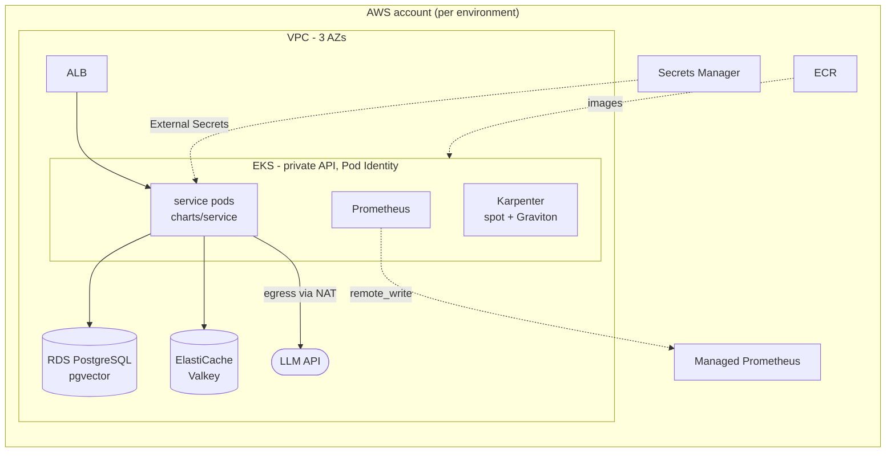

# platform-blueprint

[](https://github.com/RatulSikder97/platform-blueprint/actions/workflows/terraform.yml)
[](https://github.com/RatulSikder97/platform-blueprint/actions/workflows/chart.yml)
[](https://github.com/RatulSikder97/platform-blueprint/actions/workflows/app.yml)
[](https://github.com/RatulSikder97/platform-blueprint/actions/workflows/e2e.yml)

A reference AWS platform for running **AI/LLM-backed microservices**, built
entirely as code. It covers Terraform for the account foundation (VPC, EKS +
Karpenter, RDS PostgreSQL with pgvector, ElastiCache Valkey, ECR,
observability), a hardened reusable Helm chart for services, a small Go demo
service, and CI that validates all of it **without touching a cloud account**.
The same chart and observability path run end to end on a local `kind` cluster.

It is opinionated and secure by default. Each choice is written down in an ADR.



See [docs/architecture.md](docs/architecture.md) for the full topology,
request path and security posture.

## Repository map

```
terraform/
  bootstrap/            S3 state bucket (versioned, KMS, TLS-only), optional DynamoDB lock table
  modules/
    vpc/                3-AZ VPC, public/private/database tiers, NAT none|single|per_az, endpoints, flow logs
    eks/                EKS + access entries, KMS, managed add-ons, system node group, IRSA, Karpenter IAM/SQS/EventBridge
    rds-postgres/       PostgreSQL 16-18, pgvector-tuned params, TLS-only, IAM auth, RDS-managed secret, PITR
    elasticache-redis/  Valkey/Redis, TLS required, AUTH token in Secrets Manager, Multi-AZ failover
    ecr/                Immutable repos, scan on push, KMS, lifecycle
    observability/      SNS alerts, optional AMP (+ Pod Identity remote-write role) and AMG
  envs/staging|prod/    Composition roots, S3 backend (partial config), provider guard rails, mock-provider plan tests
charts/service/         Reusable microservice chart (Deployment, Service, HPA, PDB, NetworkPolicy,
                        ServiceMonitor, ExternalSecret, values.schema.json, helm test)
apps/demo-api/          Go service: /healthz /readyz /metrics POST /v1/summarize (fake or OpenAI-compatible LLM)
deploy/demo-api/        Per-environment chart values for EKS
platform/karpenter/     EC2NodeClass + NodePool matching the Terraform outputs
local/                  kind cluster config + up/test/down scripts
docs/                   Architecture, ADRs, deploy/rollback runbook
.github/workflows/      terraform, chart, demo-api, e2e-kind
```

## Quickstart (local, ~5 minutes)

Requirements: Docker, `kind`, `kubectl`, `helm` (v3.14+ or v4).

```bash
make local-up     # kind (3 nodes, 2 fake AZs) + metrics-server + kube-prometheus-stack + demo-api via charts/service
make local-test   # helm test, curl the API, assert Prometheus scrapes it, assert NetworkPolicy blocks other namespaces
make local-down
```

`make local-test` output:

```
PASS: helm test (in-cluster request via Service)
PASS: healthz
PASS: summarize
PASS: input validation (422)
PASS: metrics exposed
PASS: Prometheus scraping 2 demo-api target(s)
PASS: cross-namespace request blocked
All local e2e checks passed.
```

Try it by hand:

```bash
kubectl -n demo port-forward svc/demo-api 8080:80 &
curl -s localhost:8080/v1/summarize -H 'Content-Type: application/json' \
  -d '{"text":"Karpenter provisions nodes for pending pods. Lunch is at noon. Nodes are consolidated when pods leave.","max_sentences":2}'
```

The demo API uses a deterministic offline summarizer by default. To point it
at any OpenAI-compatible endpoint (OpenAI, vLLM, Ollama, LiteLLM), set
`LLM_BACKEND=openai`, `LLM_BASE_URL`, `LLM_MODEL` and an `LLM_API_KEY` that
comes from an ExternalSecret.

## Validate everything offline

```bash
make validate   # every check CI runs, no AWS credentials needed
```

| Check | Tooling |
|---|---|
| Terraform formatting | `terraform fmt -check` |
| Terraform correctness | `terraform validate` for every module, env and the bootstrap |
| Plan-level tests | `terraform test` with a **mocked AWS provider**: full staging/prod plans, NAT-mode assertions, variable validation |
| Terraform lint | `tflint` (all terraform rules + AWS ruleset) |
| Terraform security | `trivy config`, fails on MEDIUM and above |
| Chart | `helm lint --strict`, `helm template \| kubeconform -strict` (including CRDs) for 6 value sets, `trivy config` |
| App | `go vet`, `go test -race`, `golangci-lint`, Docker build, read-only container smoke test, `trivy image` |
| End to end | kind cluster: real install of kube-prometheus-stack plus the chart, then `make local-test` |

## Applying to AWS

Nothing in this repository has been applied to a real account, and CI never
needs credentials. The intended path:

1. **Bootstrap state once per account:** `terraform -chdir=terraform/bootstrap apply -var bucket_name=...`
2. **Configure the backend:** `cp terraform/envs/staging/backend.hcl.example backend.hcl`, then `terraform init -backend-config=backend.hcl`.
3. **Plan and apply** with `allowed_account_ids` (the provider refuses any other account) and `cluster_admin_principal_arns` (your SSO admin and CI deploy roles; the cluster creator gets no implicit admin).
4. **Install add-ons:** Karpenter (IAM, SQS and Pod Identity already exist), `platform/karpenter/`, kube-prometheus-stack, External Secrets.
5. **Deploy services** with `charts/service` by image digest, using `helm upgrade --atomic`.

In a real pipeline, CI assumes a role through GitHub OIDC, runs `plan` on PRs,
and runs `apply` after merge behind a protected environment.
[docs/runbook.md](docs/runbook.md) covers deploy, verification and rollback,
including data-store recovery.

## Cost estimate

> **This is an estimate, not a bill.** It uses us-east-1 on-demand list
> prices and an example application load. It excludes data transfer, per-GB
> NAT/endpoint processing, AMP ingestion and LLM API spend. The breakdown and
> cost levers are in [ADR 0004](docs/adr/0004-cost-notes.md).

| Component | staging | prod |
|---|---:|---:|
| EKS control plane | $73 | $73 |
| System node group | ~$45 (spot) | ~$179 |
| Karpenter app nodes (example) | ~$45 (spot) | ~$357 |
| NAT gateways | $33 (single) | $99 (per AZ) |
| Interface endpoints | n/a | ~$88 |
| RDS PostgreSQL | ~$50 | ~$372 (Multi-AZ) |
| ElastiCache Valkey | ~$19 | ~$256 |
| KMS / logs / SNS / Secrets Manager | ~$25 | ~$80 |
| **Approx. monthly total** | **~$290** | **~$1,500** |

## Design decisions

- [ADR 0001: EKS over ECS Fargate](docs/adr/0001-eks-over-ecs.md)
- [ADR 0002: NAT gateway strategy](docs/adr/0002-nat-strategy.md)
- [ADR 0003: Secrets via External Secrets Operator](docs/adr/0003-secrets-external-secrets.md)
- [ADR 0004: Cost posture](docs/adr/0004-cost-notes.md)

## Deliberately out of scope

The following are deliberately left out: GitOps controller (Argo CD/Flux),
ingress controller installation, multi-region and DR replicas, and GPU
NodePools for self-hosted inference. They layer on top without changing the
modules.

## License

[MIT](LICENSE)
