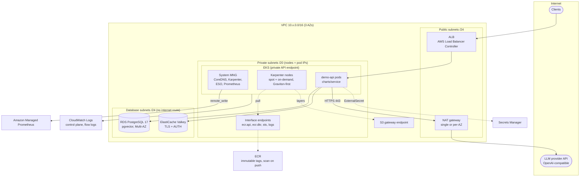
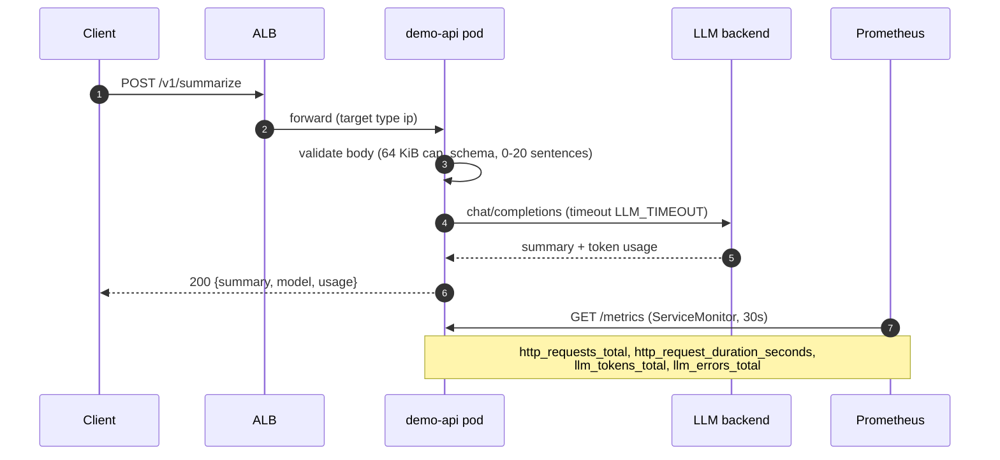

# Architecture

`platform-blueprint` is a reference platform for running stateless, LLM-backed
HTTP microservices on AWS. It is deliberately small: one VPC, one EKS cluster,
one PostgreSQL (with pgvector) and one Valkey/Redis per environment, with
everything else (ingress, GitOps, Karpenter, External Secrets) layered on as
Helm releases.

## AWS topology

## Request path

## Components

| Layer | What | Where |
|---|---|---|
| Network | 3-AZ VPC, public/private/database tiers, NAT mode toggle, S3 gateway endpoint, optional interface endpoints, KMS-encrypted flow logs, default SG with no rules | `terraform/modules/vpc` |
| Compute | EKS with API-only auth (access entries), private endpoint, KMS envelope encryption, all control-plane logs, Graviton system node group with IMDSv2 hop-limit 1, managed add-ons, Pod Identity + optional IRSA | `terraform/modules/eks` |
| Autoscaling | Karpenter v1 controller IAM (tag-scoped), interruption SQS queue + EventBridge rules, node access entry, discovery tags | `terraform/modules/eks/karpenter.tf`, `platform/karpenter/` |
| Data | RDS PostgreSQL (TLS-only, IAM auth, RDS-managed master secret, PITR, PI, pgvector-sized `maintenance_work_mem`) | `terraform/modules/rds-postgres` |
| Cache | ElastiCache Valkey/Redis, TLS required, AUTH token in Secrets Manager, Multi-AZ failover | `terraform/modules/elasticache-redis` |
| Registry | ECR, immutable tags, scan on push, KMS, lifecycle | `terraform/modules/ecr` |
| Observability | SNS alerts topic, optional AMP workspace + Pod Identity remote-write role, optional AMG | `terraform/modules/observability` |
| Workload | Reusable Helm chart: Deployment, Service, HPA, PDB, NetworkPolicy, ServiceMonitor, ExternalSecret | `charts/service` |
| Demo app | Go service with fake/OpenAI-compatible LLM backends and Prometheus metrics | `apps/demo-api` |

## Security posture (defaults)

- **No public data plane.** Nodes, pods, RDS and cache live in private or isolated subnets; public subnets don't auto-assign public IPs.
- **No public control plane.** The EKS API endpoint is private by default; the module refuses `0.0.0.0/0` if you turn on public access.
- **Identity.** EKS access entries only (no `aws-auth` ConfigMap), no implicit cluster-creator admin, workloads use EKS Pod Identity. Pods can't reach IMDS (hop limit 1, and the chart's NetworkPolicy blocks `169.254.169.254`).
- **Encryption.** Customer-managed KMS keys with rotation for EKS secrets, logs, RDS, ElastiCache, ECR, SNS and AMP. TLS is enforced on RDS (`rds.force_ssl`) and ElastiCache (`transit_encryption_mode = required`).
- **Secrets.** Nothing secret goes through Terraform variables or Helm values. RDS manages its own master password in Secrets Manager; the cache AUTH token is generated and stored in Secrets Manager; pods get both through External Secrets.
- **Pod hardening.** The chart runs pods as non-root (uid 65532) with a read-only root filesystem, all capabilities dropped, the `RuntimeDefault` seccomp profile, no service-account token, default-deny NetworkPolicy plus explicit allows, and a distroless image.
- **Supply chain.** All GitHub Actions are pinned to commit SHAs. Trivy scans the Terraform, the chart and the image in CI. ECR tags are immutable.

## Environments

| | staging | prod |
|---|---|---|
| NAT | single | one per AZ |
| Interface endpoints | none | ecr.api, ecr.dkr, sts, logs |
| System nodes | 2x Graviton, **spot** | 3x m7g.large on-demand, `CriticalAddonsOnly` taint |
| PostgreSQL | db.t4g.medium, single-AZ, 3-day PITR, no deletion protection | db.r7g.large, Multi-AZ, 14-day PITR, deletion protection |
| Cache | 1x cache.t4g.small | 2x cache.r7g.large, auto-failover |
| Metrics | in-cluster Prometheus | in-cluster Prometheus + AMP remote write |

## Why the tests use mocks

`terraform test` runs each environment's full plan against a mocked AWS
provider (`tests/*.tftest.hcl`). That catches broken module wiring, variable
validation regressions and plan-time errors (one such error, `for_each` over
apply-time security group IDs, was caught this way) with no credentials and no
cost. It can't tell you whether AWS will accept the API calls. Only a real
`plan`/`apply` against a sandbox account does that, and that step belongs in
the deploy pipeline (see [runbook](runbook.md)).
